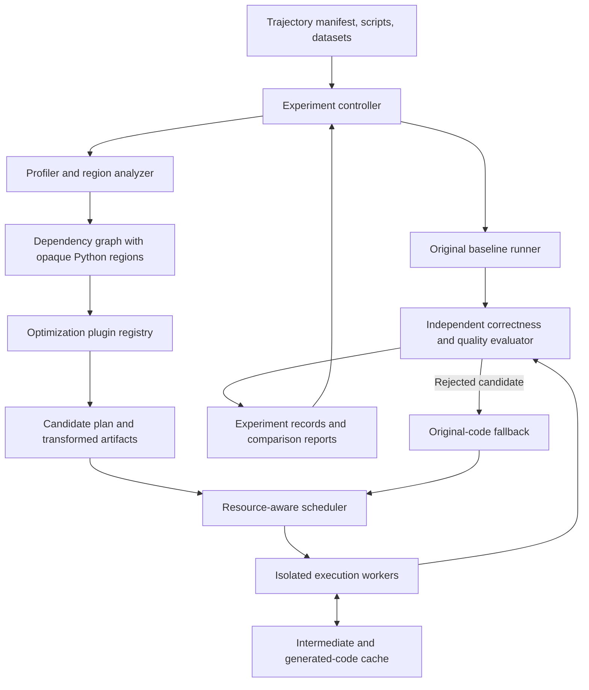

# Experimental Architecture for Optimizing Agent-Generated ML Pipelines

## Recommendation and current evidence

Build an experiment-first architecture with interchangeable optimization plugins. Begin by testing cross-pipeline reuse and resource-aware execution, then evaluate compiler rewrites and LLM assistance through the same harness before committing to them.

This recommendation is a hypothesis based on repository inspection, not a measured result. No benchmarks have been run for this proposal. The required CSV files are currently absent from `spaceship_titanic_students/input/`.

The project brief, `docs/L2_Project.pdf`, particularly slides 8–10, requires:

- Ten fixed trajectories: five provided and five collected, each containing at least 20 pipelines.
- Trajectory execution time compared with the original baseline.
- Preservation of the best validation score within a specified tolerance.
- Reporting LLM inference time when used.

The current repository provides one trajectory with 25 pipelines across seven steps. Its `spaceship_titanic_students/trajectory.json` manifest explicitly permits concurrency within each step and requires barriers between steps. Every fixed candidate must be replayed.

Three concrete opportunities support the initial recommendation:

- Pipelines repeatedly perform similar feature engineering and fold preprocessing.
- Step-seven variants repeat identical model training and differ in decision thresholds, allowing potential reuse of predicted probabilities.
- Random forests explicitly use `n_jobs=1`, while the reference runner executes candidates sequentially.

The existing `profile_trajectory.py`, `trace_libraries.py`, and `report_categories.py` scripts provide a diagnostic foundation. Final speed measurements should come from unprofiled runs.

## 1. Evaluation of optimization alternatives

Priorities indicate what to investigate first, not expected speedup figures.

| Direction and alternative | Potential benefit | Main limitation or risk | Initial priority |
|---|---|---|---|
| Runtime: intra-operator parallelism | Accelerate eligible training and preprocessing operations | Small tasks may not amortize thread overhead; nested parallelism can oversubscribe CPUs | High |
| Runtime: inter-operator and within-step concurrency | Overlap independent folds, models, or candidates | Increased memory demand and resource contention; preserve step barriers | High |
| Runtime: efficient representation | Reduce copies, serialization, and dense intermediate storage | Aliasing, dtype changes, or sparse conversion can change behavior | Medium |
| Runtime: adaptive execution | Select thread counts or backends using measured workload properties | Profiling and tuning can cost more than they save | After fixed policies |
| Cross-pipeline: intermediate reuse | Avoid repeated feature engineering and fold preprocessing | Correct cache identity must include data, parameters, and training folds | Highest |
| Cross-pipeline: common computation detection | Discover reusable regions despite superficial source differences | General equivalence detection for arbitrary Python is difficult | High, restricted patterns |
| Cross-pipeline: generated code reuse | Amortize compilation and LLM generation across compatible workloads | Requires versioned artifacts and compatibility checks | Enable with code generation |
| Cross-pipeline: incremental computation | Recompute only downstream nodes after a change | Updating fitted models is algorithm-specific and may alter results | DAG invalidation first |
| Compiler: vectorization, pruning, redundant-work elimination | Remove Python loops and unused feature computations | Must preserve dependencies, exceptions, and observable outputs | High |
| Compiler: Pandas-to-Polars substitution | Potential gains for substantial data preparation regions | Conversion overhead and semantic differences | Medium, regional |
| Compiler: Rust kernels and specialization | Accelerate repeated Python-heavy hotspots | Compilation, bindings, maintenance, and restricted applicability | Conditional |
| Compiler: CPU/GPU backend selection | Potential gains for sufficiently large supported operations | Transfers, initialization, hardware dependence, numerical differences | Later experiment |
| LLM: planning and code repair | Find opportunities and repair proposed transformations | Variable reliability and inference cost | Bounded experimental arm |
| LLM: translation and kernel generation | Handle transformations beyond fixed rules | Requires strong differential validation | Conditional |
| LLM: algorithm substitution | Potentially large training-time reductions | Changes predictive behavior and complicates attribution | Separate quality-constrained arm |
| LLM: hybrid optimization | Use deterministic rules for common cases and LLMs for residual hotspots | More components and validation expense | After simpler baselines |

Thread control must cover both estimator parallelism and native BLAS/OpenMP pools; `n_jobs` alone does not control every layer. See [scikit-learn's parallelism documentation](https://scikit-learn.org/stable/computing/parallelism.html).

Polars substitution should target complete compatible regions. Its indexing and type semantics differ from Pandas, so import replacement is insufficient. See the [Polars migration guide](https://docs.pola.rs/user-guide/migration/pandas/).

Use Amdahl's law as an initial screening bound:

```text
maximum_speedup = 1 / (1 - affected_runtime_fraction)
```

If an optimization affects only 10% of runtime, even eliminating that work entirely gives at most approximately 1.11× speedup. Measure the affected fraction before investing in a backend.

## 2. Architecture for preliminary experiments

Use a single-machine Python application with isolated worker processes, a local artifact store, and SQLite experiment metadata. Distributed infrastructure is unnecessary for the first experiments.



| Component | Responsibility |
|---|---|
| Experiment controller | Expand configurations into trials; enforce budgets, repetitions, seeds, and cache policies |
| Trajectory adapter | Read existing manifests and scripts; preserve ordering, dependencies, validation splits, and outputs |
| Baseline runner | Execute original scripts under the same resource limits and collect reference artifacts |
| Profiler and analyzer | Combine current Scalene/library tracing with source analysis to identify costly and repeated regions |
| Region graph | Represent supported reads, transformations, fits, predictions, and scoring; retain unsupported code as opaque regions |
| Optimization plugins | Propose resource policies, caching boundaries, rewrites, alternate backends, or LLM-generated candidates |
| Scheduler and workers | Enforce step barriers, CPU/memory budgets, timeouts, and isolated output directories |
| Cache and artifact store | Store immutable intermediates, predictions, generated kernels, logs, and provenance |
| Independent evaluator | Recompute scores and compare intermediate/output semantics |
| Reporter | Produce speedup, quality, overhead, memory, coverage, failure, and ablation results |

The main architectural choice is a partial dependency graph. Recognize a small set of useful operations while allowing arbitrary Python to execute unchanged. A full Python compiler would consume substantial effort before producing evidence.

The Stratum example in the PDF starts with structured DataOps plans. This repository starts with Python scripts, so constructing reliable optimization boundaries is an additional problem.

### Data flow

1. Fingerprint code, input data, dependencies, hardware configuration, and evaluation policy.
2. Execute or locate the matching baseline reference.
3. Use diagnostic profiles to identify candidate regions.
4. Ask enabled plugins for transformations with explicit applicability conditions.
5. Validate proposed regions against original behavior.
6. Execute the fixed trajectory with the selected plan, preserving its barriers.
7. Independently evaluate outputs, record all overhead, and reject unsafe candidates.
8. Aggregate repeated trials and compare alternatives.

For manually extracted experimental regions, report results as potential benefit. Report automatic optimization coverage separately so handcrafted prototypes are not mistaken for an automatic system.

## 3. Preliminary experiment programme

Start with the available trajectory to test feasibility. Add diverse trajectories before choosing the final strategy.

| Experiment | Comparison | Evidence it provides |
|---|---|---|
| E0: baseline and overhead | Original runner versus harness with all optimizations disabled; separate profiling runs | Runtime variability, harness tax, bottleneck distribution |
| E1: parallel execution | Sequential; operator parallelism; within-step concurrency; controlled combination | Best allocation of a fixed CPU budget and memory cost |
| E2: reuse | No cache; feature cache; fold-preprocessing cache; prediction cache | Where repeated work occurs and whether reuse beats hashing/storage costs |
| E3: deterministic rewrites | Original versus vectorization, unused-feature pruning, and redundant-operation elimination | Benefit from relatively simple source transformations |
| E4: alternative implementations | Original region versus equivalent Polars region or specialized Rust kernel | Runtime crossover after conversion and compilation costs |
| E5: LLM assistance | Rules alone versus rules plus bounded LLM proposals; algorithm substitutions separately | Incremental coverage and speedup attributable to the LLM |
| E6: combinations | Best individual strategies, combined strategy, and leave-one-out ablations | Whether gains compose or interfere |
| E7: generalization | Freeze strategy and evaluate untouched trajectories | Whether the choice generalizes beyond development examples |

For E1, sweep worker counts of 1, 2, and 4 where hardware permits, with explicit per-worker native thread limits. Do not compare an optimized eight-core run against a baseline restricted to one core without labeling that resource difference.

For E2, first test threshold variants: reuse their identical probability-producing computation, then recompute each threshold's score and required artifacts. Each candidate still produces its own result.

For E4, test native dataset sizes plus controlled scaling experiments. Artificial enlargement can establish performance crossover points, but should not support predictive-quality claims.

For E5, initially allow at most three proposals and one repair per proposal, under a recorded time/token budget. Give the LLM source, schemas, and profiles; keep evaluator logic and validation labels outside its editing scope.

Use the five provided trajectories for development and freeze the strategy before evaluating the five collected trajectories. Choose the latter for workload diversity rather than similarity to Spaceship Titanic.

### Measurement protocol

- Begin with five paired unprofiled repetitions; extend noisy cases up to ten.
- Randomize baseline/optimized run order and run competing configurations without unrelated concurrent workloads.
- Hold data, code, folds, seeds, environment, and resource limits fixed.
- Start the primary run with empty optimization caches; allow reuse to accumulate naturally within the trajectory.
- Report persistent warm-cache performance as a separate experiment.
- For concurrent execution, measure trajectory wall-clock duration rather than summing candidate durations.

Define the primary metric as:

```text
cold_speedup = original_trajectory_time / optimized_end_to_end_time
```

The denominator runs from optimizer start to verified trajectory completion. It includes required analysis, LLM calls, compilation, cache operations, failed attempts, and fallback. If an optimizer requires a fresh profiling pass, charge it to the cold result. Diagnostic profiling used only for research is reported separately.

Also report execution-only speedup, peak process-tree memory, CPU-seconds, cache bytes/hits, optimization coverage, and failure/fallback rates. Use per-trajectory results and a geometric mean across trajectories, with uncertainty estimates.

For repeated use, report the break-even count:

```text
break_even_runs = ceil(
    one_time_optimization_cost / (baseline_time - optimized_execution_time)
)
```

This is meaningful only when optimized execution is faster.

## 4. API and correctness contracts

A Python API and CLI are sufficient initially; an HTTP service would add little experimental value. The following signatures describe proposed interfaces, not implemented functions.

```python
run_experiment(spec: ExperimentSpec) -> ExperimentResult

analyze(trajectory: TrajectorySpec) -> AnalysisReport

propose(
    graph: RegionGraph,
    analysis: AnalysisReport,
    budget: OptimizationBudget,
) -> list[CandidatePlan]

execute(plan: CandidatePlan, context: RunContext) -> RunResult

validate(
    reference: RunResult,
    candidate: RunResult,
    policy: QualityPolicy,
) -> ValidationResult
```

| Type | Required information |
|---|---|
| ExperimentSpec | Trajectories, enabled strategies/settings, repetitions, resources, cache mode, optimization budget, quality policy |
| CandidatePlan | Parent/source hashes, changed regions, dependencies, preconditions, semantic category, generated artifacts, fallback |
| RunResult | Status, wall time, component timings, peak memory, outputs, scores, cache events, logs, environment fingerprint |
| ValidationResult | Pass/fail, score difference, artifact mismatches, comparison tolerances, failure reason |

Each plugin implements `supports`, `propose`, and `materialize`. Plugins return candidate artifacts; the controller owns execution and evaluation.

### Optimization modes

- **Semantics-preserving:** Preserve row identities, folds, labels, feature meaning, output schema, and prediction behavior. Compare discrete results exactly and floating-point values using declared tolerances.
- **Quality-constrained:** Allow changes such as algorithm substitution, subject to an explicitly configured metric tolerance. Report these independently.

For a higher-is-better metric, acceptance requires:

```text
optimized_best_score >= baseline_best_score - epsilon
```

Reverse the inequality appropriately for lower-is-better metrics. Record every pipeline's score as well: the best trajectory score can otherwise hide serious regressions. For accuracy, an exploratory tolerance could be `0.001` absolute, but this is a proposed setting, not a requirement from the PDF. Default semantics-preserving experiments to no accuracy loss.

Recompute scores from saved predictions, row identifiers, labels, folds, and the declared decision rule. Do not trust printed scores alone. The current trajectory's different thresholds make recording the decision rule essential.

### Cache correctness

Cache identity must include the operation and relevant dependencies, parameters, input fingerprints, ordered columns/rows, dtypes, library versions, seeds, and fit-row identity. Include labels for operations that consume them. Fitted preprocessing must never be reused across incompatible folds.

Existing feature construction uses combined train/test features in some places. Preserve and document that baseline protocol; do not silently redesign it during an optimization comparison.

## 5. Error handling and validation

| Failure | Required behavior |
|---|---|
| Unsupported or ambiguous Python region | Execute original region and record skipped coverage |
| Compilation or generated-code failure | Apply the bounded repair policy, then fall back |
| Prediction/schema/quality mismatch | Reject the candidate; invalidate its affected cache artifacts |
| Timeout, out-of-memory, or worker crash | Stop the worker process tree, retain diagnostics, and use fallback if budget remains |
| Corrupt or stale cache entry | Treat as a miss and recompute; publish replacement atomically |
| LLM service failure | Bounded retry within the same budget, then deterministic fallback |
| Baseline failure | Mark the workload invalid for speedup comparison; report it explicitly |
| Experiment interruption | Resume completed immutable trials; restart incomplete trials under their declared cache policy |

Use per-key coordination for concurrent cache production, immutable cached outputs, and isolated trial directories. Failed attempts and retries remain part of measured cost.

Before relying on performance results, test:

- Cache invalidation when data, folds, seeds, columns, or parameters change.
- No reuse of fitted state across folds.
- Step-barrier enforcement and resource limits.
- Row alignment, null handling, unseen categories, and output equivalence.
- Worker crashes, partial cache writes, timeouts, and fallback accounting.

## 6. Selection criteria, trade-offs, and assumptions

### Selection criteria

Prefer the simplest strategy that passes correctness checks and demonstrates positive cold end-to-end benefit on development trajectories. Treat a 10% geometric-mean gain as an initial practical target, alongside memory limits and per-trajectory regressions. Freeze that rule before final evaluation.

The initial choice to test is fold-aware reuse plus bounded within-step concurrency, followed by deterministic pruning/vectorization. Rust, GPU execution, and LLM generation should earn inclusion through measured residual bottlenecks, net speedup, and amortization, not through kernel speed alone.

### Trade-offs

- Restricted rules and exact reuse offer narrower coverage but are easier to validate; general compiler or LLM transformations increase coverage and validation cost.
- Cross-pipeline caching avoids computation but adds hashing, storage, serialization, invalidation, and memory costs.
- Concurrency reduces elapsed time only when spare resources exist; it can increase peak memory and total CPU consumption.
- Compilation and LLM generation may benefit repeated workloads while slowing a first execution, so cold and amortized results must remain separate.
- A partial dependency graph enables incremental development but leaves unsupported Python regions unoptimized.
- A local execution architecture keeps experiments reproducible and manageable; distributed execution remains a future extension if workload sizes justify it.

### Assumptions and defaults

- The first implementation targets the repository's tabular Python ML workload on one machine; GPU and distributed execution are optional later experiments.
- Fixed trajectories are replayed without changing their candidate set, validation protocol, or step dependencies.
- The benchmark datasets and remaining trajectories will be obtained before experimental claims are made.
- Environment dependencies are pinned for benchmark runs, and hardware/resource settings are recorded.
- The five provided trajectories form the development set; the five collected trajectories form the untouched final evaluation set.
- Optimization caches start empty for the primary measurement and can fill during a trajectory; persistent-cache runs are reported separately.
- Semantics-preserving transformations are the default. Algorithm substitution requires the separate quality-constrained mode and an explicit tolerance.
- Opaque or unsupported code remains executable through the original-code path.
- The system is a research prototype for supplied workloads. Worker isolation is for reproducibility and resource control, not a claim of secure execution of adversarial code.

## References

- Project specification: `docs/L2_Project.pdf`, especially slides 8–10 and 13–16.
- Current trajectory contract: `spaceship_titanic_students/trajectory.json`.
- Profiling workflow: `ANALYSIS_INSTRUCTION.md`.
- [scikit-learn parallelism and resource management](https://scikit-learn.org/stable/computing/parallelism.html).
- [Polars migration guide for Pandas users](https://docs.pola.rs/user-guide/migration/pandas/).
